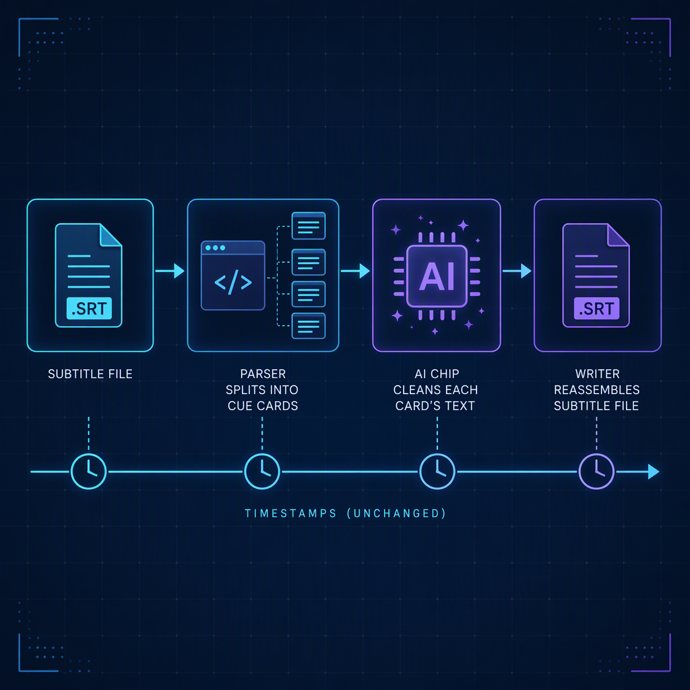

# Cleaning SRT and WebVTT subtitles in .NET with s1-mini

After I published [the first post about s1-mini](26-08-20-intro.md), a reader (hi, Isaac!) sent me a message: he generates SRT files for his podcast and wanted to pass them straight into the library. His second message was the real problem: the model does not handle timestamps.

He is right. [`superwhisper/s1-mini`](https://huggingface.co/superwhisper/s1-mini) only knows how to rewrite text. But that does not block the feature. The model never needs to see a timestamp. The library can parse the file, clean only the text, and put the timestamps back exactly as they were.

That is what `ElBruno.S1Mini` **0.2.0** does.

## The one-liner

```bash
dotnet add package ElBruno.S1Mini --version 0.2.0
```

```csharp
using ElBruno.S1Mini.Normalization;

using var normalizer = await TranscriptNormalizer.CreateAsync();

var srt = await File.ReadAllTextAsync("episode.srt");
var cleaned = await normalizer.NormalizeSubtitlesAsync(srt);

await File.WriteAllTextAsync("episode.clean.srt", cleaned);
```

The format is auto-detected: content starting with `WEBVTT` is WebVTT, everything else is SRT. You can also pass it explicitly.

## What goes in, what comes out

Input:

```text
1
00:00:01,000 --> 00:00:03,500
um so <i>hello</i>
there everyone

2
00:00:04,000 --> 00:00:05,000
um uh

3
00:00:06,000 --> 00:00:08,000
welcome back to the the show
```

Output (illustrative, the exact wording comes from the model):

```text
1
00:00:01,000 --> 00:00:03,500
So hello there everyone.

2
00:00:04,000 --> 00:00:05,000


3
00:00:06,000 --> 00:00:08,000
Welcome back to the show.
```

Cue 2 was pure filler, so the model returns an empty string and the cue stays in place with empty text. That keeps the file aligned with the audio. If you would rather remove it:

```csharp
var cleaned = await normalizer.NormalizeSubtitlesAsync(
    srt,
    dropEmptyCues: true);
```

With `dropEmptyCues`, SRT cues are renumbered so the indexes stay sequential.

## How it works



The implementation is three small pieces in `Normalization/`:

1. **`SubtitleParser.Parse`** splits the file into blocks and builds a `SubtitleCue` for each one. It handles CRLF, a BOM, and multi-line cues. WebVTT `NOTE`, `STYLE` and `REGION` blocks are skipped.
2. **`NormalizeAsync` per cue.** Markup tags such as `<i>` or `<v Bob>` are stripped and multi-line text is joined into one line before the model sees it.
3. **`SubtitleParser.Write`** serializes the cues back to the same format.

The cue type keeps the timing line as a raw string, so nothing can drift:

```csharp
public sealed record SubtitleCue(string? Identifier, string Timing, string Text);
```

That means WebVTT cue settings like `align:start` survive the round trip, along with cue identifiers.

The core of the loop is short:

```csharp
foreach (var cue in cues)
{
    var plain = Regex.Replace(cue.Text, "<[^>]+>", string.Empty);
    plain = Regex.Replace(plain, @"\s+", " ").Trim();

    var cleaned = await NormalizeAsync(plain, options, cancellationToken);

    if (cleaned.Length == 0 && dropEmptyCues)
        continue;

    result.Add(cue with { Text = cleaned });
}
```

## WebVTT works the same way

```csharp
var vtt = await File.ReadAllTextAsync("episode.vtt");

var cleaned = await normalizer.NormalizeSubtitlesAsync(
    vtt,
    SubtitleFormat.WebVtt,
    new TranscriptNormalizerOptions { Styling = TranscriptStyling.Casual });
```

Input:

```text
WEBVTT

intro
00:00:01.000 --> 00:00:02.000 align:start
<v Bob>um hi
```

Output (illustrative):

```text
WEBVTT

intro
00:00:01.000 --> 00:00:02.000 align:start
Hi.
```

## Testing it without a model

The existing `TranscriptNormalizer(IChatClient)` constructor makes this easy to test offline. The tests use a fake chat client that returns queued responses:

```csharp
var fake = new FakeChatClient();
fake.EnqueueResponse("So hello there everyone.");
fake.EnqueueResponse("");
fake.EnqueueResponse("Welcome back.");
using var normalizer = new TranscriptNormalizer(fake);

var output = await normalizer.NormalizeSubtitlesAsync(srt);

Assert.Equal(3, fake.CallCount);
```

Because the parser and writer are plain code, the timestamp guarantees are checked with exact string comparisons, no model required.

## Known limitation: cues are cleaned one at a time

The model is stateless, so each cue is normalized without seeing its neighbors. Subtitle cues often split mid-sentence, and in that case punctuation and capitalization will be less accurate than when cleaning full paragraphs. A cue that ends mid-sentence may get a period it does not need.

A future version could merge cues into sentence-sized groups, normalize them, and redistribute the text across the original time ranges. That is a bigger design (word-level timing is lost once filler and self-corrections are removed), so I shipped the simple, predictable version first. If you have podcast SRTs where this matters, please open an issue with a sample.

## Links

- NuGet: [`ElBruno.S1Mini`](https://www.nuget.org/packages/ElBruno.S1Mini)
- GitHub: [elbruno/ElBruno.S1Mini](https://github.com/elbruno/ElBruno.S1Mini)
- Model: [`superwhisper/s1-mini`](https://huggingface.co/superwhisper/s1-mini)

Thanks Isaac for the idea!
